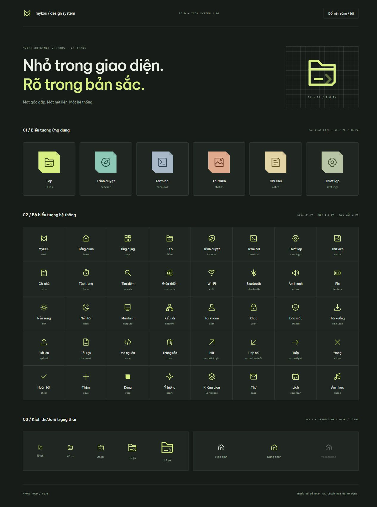
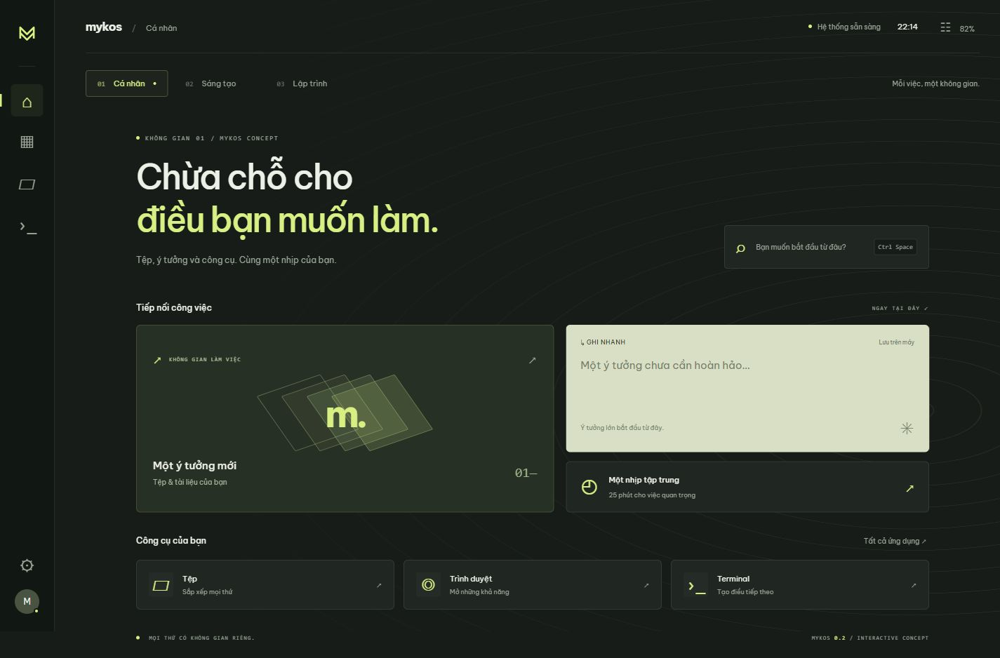

# MyKOS design system

MyKOS Fold 1.0 icon system and the MyKOS 0.2 interactive desktop concept.
These are design exploration assets and a browser prototype, not an implemented
Plasma shell, an installable OS, or an installed KDE icon theme.

## Preview

From the repository root:

```sh
python3 -m http.server 5174 --bind 127.0.0.1 --directory design-system
```

Open http://127.0.0.1:5174/ for the desktop concept, or
http://127.0.0.1:5174/icons.html for the icon catalog. No npm installation is needed.
When running from this directory directly, omit `--directory design-system`.
Typography uses Google Fonts with a local sans-serif fallback.

## Contents

- `index.html`, `app.js`, `style.css`: workspace-based desktop prototype.
- `icons.html`, `icons.css`, `icons.js`: icon catalog, application emblems and inline SVG renderer.
- `assets/icons/`: 40 original 24-unit SVGs, a named sprite and construction guidance.
- `assets/app-icons/`: six standalone colored application SVGs, using a 96-unit viewBox.
- `tools/build-icons.cjs`: original geometry and reproducible export generator.
- `mykos-fold-icons.zip`: portable icon kit and catalog.

From this directory, regenerate assets with Node.js:

```sh
node tools/build-icons.cjs
```

The ZIP is a convenience export; regenerating assets does not refresh it.

## Design language

Matte ink-green surfaces, lime accents, topographic lines, and a small folded
corner connect the shell concept and icon family. System icons use a 24 × 24
viewBox, a 1.6-unit stroke, round caps and joins, and `currentColor` for theming.
Application emblems share the same glyph geometry with distinct material colors.
See [icon construction guidance](assets/icons/README.md).

The concept includes three activity workspaces, per-workspace notes stored in
browser localStorage, app search (Ctrl/Meta + Space), light/dark appearance and a
25-minute focus timer. Connectivity controls, files, terminal and gallery are
illustrative; they do not change the host OS or access its files. Web search
opens an external browser tab. The focus timer resets on page reload.

## Validation

- JavaScript syntax checked for application, renderer and generator.
- All 47 exported SVG files parsed as XML (40 glyphs, six app emblems, one sprite).
- Browser checks covered icon rendering, dynamic application windows, app search,
  workspace notes, focus timer and light/dark appearance.
- Desktop and narrow viewport layouts were inspected; OS integration is not tested.

## Previews





## Native implementation

The concept is now consumed by [the native desktop integration](../desktop/README.md):
a Qt 6/QML Workspace companion, KDE color schemes, a Fold icon theme with Breeze
fallback, and wallpaper resources. The browser files remain design references.
Regenerate native exports with `python3 scripts/build/export-design.py` from the
repository root. This does not replace Plasma or imply a validated OS image.
