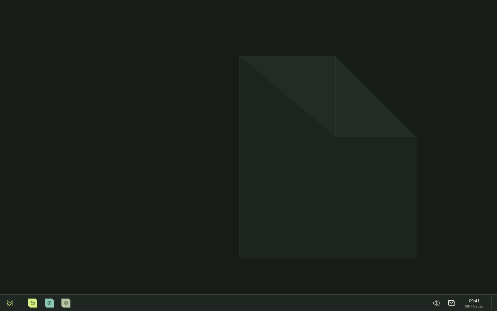
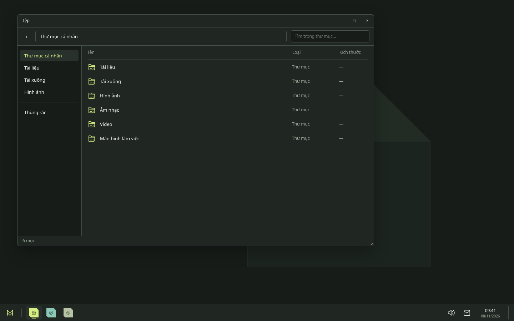

# M1 — Thiết kế desktop MyKOS

Bản thiết kế 2.0 thay thế bố cục M1 cũ. Desktop mặc định chỉ có hình nền và panel cạnh dưới. Không có khẩu hiệu, thẻ dự án, trang tổng quan hoặc Workspace tự mở.

## Xem bản mẫu

Chạy từ thư mục gốc:

```sh
python3 -m http.server 5174 --bind 127.0.0.1 --directory design-system
```

Mở [desktop M1](http://127.0.0.1:5174/m1/). Bản mẫu chiếm toàn khung trình duyệt, không có thanh điều hướng trang web. Bấm biểu tượng MyKOS để mở menu; bấm Tệp hoặc Thiết lập trên panel để mở cửa sổ. Menu hỗ trợ tìm có/không dấu và Enter/Escape. Có thể kéo, thay cỡ, thu nhỏ và phóng to cửa sổ minh họa.

**F1** mở công cụ xem thiết kế dành cho người rà soát; công cụ này mặc định ẩn và không thuộc desktop đề xuất. Màn hình đăng nhập chỉ minh họa, không nhập mật khẩu thật. Không có thao tác nào thay đổi hệ điều hành hoặc truy cập tệp trên máy. Âm lượng và ngày giờ là giá trị mẫu.

## Tài liệu

- [Đặc tả desktop và ánh xạ KDE](SPEC.md).
- [Giá trị màu, chữ, kích thước](tokens.json).
- [Kết quả kiểm tra và giới hạn](VALIDATION.md).
- Kiểm tra tương phản: `python3 design-system/m1/check-contrast.py`.

## Xem trước

### Desktop mặc định



### Cửa sổ quản lý tệp



Các ảnh khác: [desktop sáng](previews/desktop-paper.png), [menu ứng dụng](previews/launcher-paper.png), [thiết lập](previews/settings-paper.png), [thông báo rỗng](previews/notifications-paper.png), [đăng nhập](previews/login-paper.png).

Đã bổ sung gói giao diện Plasma `org.mykos.desktop` vào lớp cấu hình ảnh hệ thống, cùng hình nền tối và bố cục panel cho hồ sơ mới. Bố cục chỉ tạo khi chưa có panel, dùng Kickoff, danh sách cửa sổ, khay hệ thống, đồng hồ và hiện desktop; không mở Workspace. Hiện chỉ ghim Dolphin đã xác định có trong ảnh; các nút ghim khác trong bản mẫu cần đối chiếu ứng dụng cài đặt trước khi thêm vào cấu hình thật.

Cấu hình đã qua kiểm thử quy tắc tạo panel, **chưa được kiểm chứng trong một ISO mới hoặc phiên Plasma thực tế**. Ảnh trên trang này vẫn là bản mẫu trình duyệt. Workspace native hiện có chưa được thiết kế lại trong thay đổi này; ứng dụng vẫn là tùy chọn và không tự khởi chạy.
