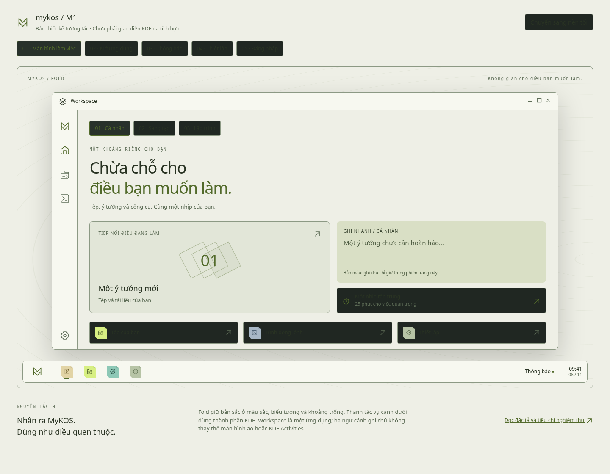
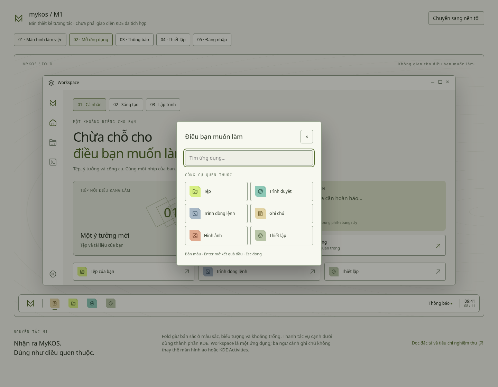
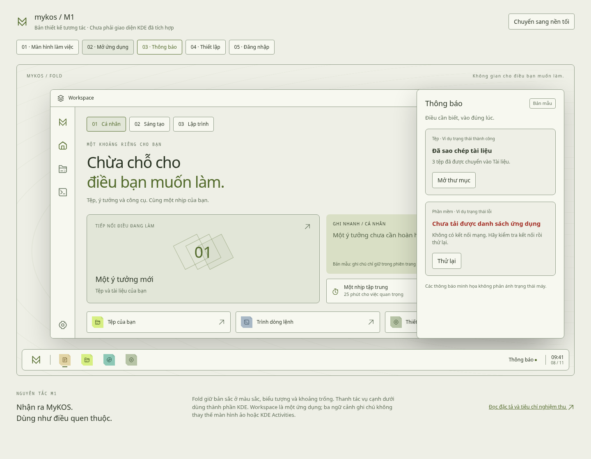
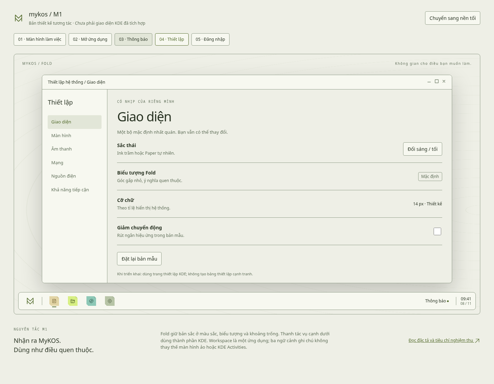
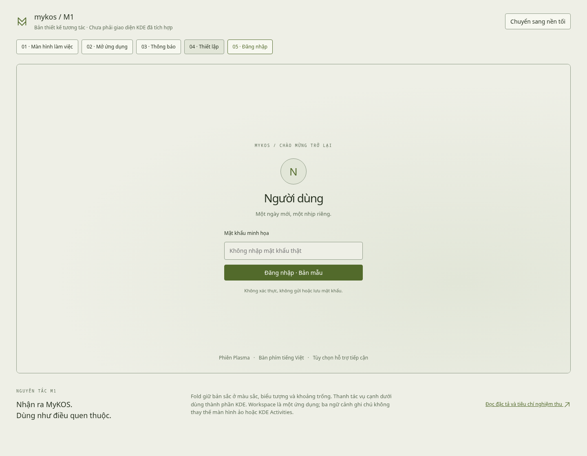

# Thiết kế M1 — Trải nghiệm môi trường làm việc

**Trạng thái: bộ thiết kế để triển khai, chưa phải M1 đã nghiệm thu.** M0 vẫn còn các tiêu chí riêng. Bản mẫu không thay thiết lập hệ điều hành và không gửi dữ liệu qua mạng.

## Xem và sử dụng

Từ thư mục gốc repo:

```sh
python3 -m http.server 5174 --bind 127.0.0.1 --directory design-system
```

Mở [bản xem M1](http://127.0.0.1:5174/m1/). Không cần npm, không tải phông hoặc thư viện ngoài. Màn hình rộng dùng bố cục desktop; màn hình hẹp xếp lại bảng xem thiết kế để dễ đọc.

Chọn năm màn hình trên thanh phía trên. Nút sáng/tối đổi toàn bộ bản mẫu. Trong menu ứng dụng, tìm không dấu hoặc có dấu, nhấn Enter chọn kết quả đầu và Escape để đóng. Ba ngữ cảnh giữ ghi chú riêng trong phiên trang; đồng hồ tập trung có thể bắt đầu/dừng. Tải lại trang sẽ đặt lại trạng thái. Màn hình đăng nhập chỉ minh họa, không dùng mật khẩu thật.

## Bộ bàn giao

| Tệp | Nội dung |
|---|---|
| [SPEC.md](SPEC.md) | Bố cục, luồng tương tác, trạng thái lỗi, tiếp cận, ánh xạ KDE, phục hồi và nghiệm thu |
| [tokens.json](tokens.json) | Vai trò màu Ink/Paper, chữ, khoảng cách, kích thước và chuyển động |
| `index.html`, `review.css`, `review.js` | Bản mẫu trình duyệt độc lập dùng lại tài nguyên Fold |
| [VALIDATION.md](VALIDATION.md) | Kiểm tra đã thực hiện và giới hạn kết luận |
| `check-contrast.py` | Kiểm tra tương phản chữ bằng Python chuẩn |
| `previews/` | Ảnh chụp trực tiếp từ bản mẫu để xem ngay trên GitHub |

## Quyết định chính

- Panel hệ thống cạnh dưới, dùng thành phần Plasma; thanh dọc chỉ thuộc Workspace.
- Giữ Fold và hai bảng màu Ink/Paper, dùng Noto Sans ngoại tuyến.
- Dùng Kickoff/KRunner, thông báo KDE, trang thiết lập KDE, SDDM và màn hình khóa gốc.
- Cấu hình mặc định dành cho hồ sơ mới, không tự ghi đè tùy biến của người dùng.
- Phân biệt giao diện minh họa, tương tác đã có trong Workspace và tích hợp chưa thực hiện.

## Ảnh xem trước

### Màn hình làm việc — Ink


### Màn hình làm việc — Paper



### Trình mở ứng dụng



### Thông báo



### Thiết lập



### Đăng nhập


